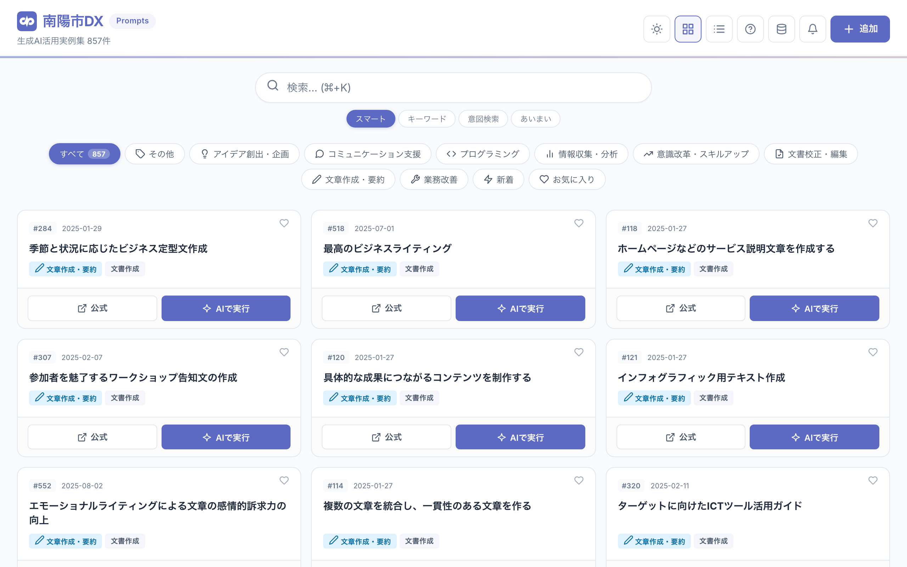

# 南陽市DX Prompts

山形県南陽市が公開している生成AIプロンプト実例集を、職員や市民がキーワードで探して、入力欄を埋めるだけで ChatGPT・Gemini・Claude に貼り付けて使えるようにした Web アプリです。

**デモ: [https://nanyo-prompt.vercel.app/](https://nanyo-prompt.vercel.app/)**

[](https://github.com/BoxPistols/nanyo-prompt-app/actions/workflows/ci.yml)
[](https://github.com/BoxPistols/nanyo-prompt-app/actions/workflows/sync-nanyo-data.yml)
[](./LICENSE)



南陽市の公式の許諾を得て、DX 担当者と直接調整のうえ Web アプリ化しました。個人が開発・運営しています。

## 見どころ

- **上流データとの日次自動同期（SHA による差分検知）** — 南陽市の GitHub リポジトリのファイルツリーを毎日取得し、前回の SHA と比べて追加・更新・削除だけを反映してコミットします。[`scraper/sync_upstream.py`](scraper/sync_upstream.py) / [`.github/workflows/sync-nanyo-data.yml`](.github/workflows/sync-nanyo-data.yml)
- **上流 HTML からの入力フォーム再構成** — 元ページの見出し（`h3`）と `textarea` で組まれた入力欄を、取得した本文テキストから変数として取り出し、見出しとサブ項目の重複をまとめて入力フォームを作り直します（詳細は下の「HTMLプロンプトのパース処理について」）。[`src/App.jsx`](src/App.jsx)（`PromptRunModal`）
- **表記ゆれに強い検索** — 正規化、関連語への意図展開、bigram の Dice 係数によるあいまい一致を組み合わせ、タイトル・カテゴリをスコア順に並べます。「意図検索」モードでは本文も検索対象にします。[`src/utils/search.js`](src/utils/search.js)

## クイックスタート

```bash
npm install
npm run dev      # 開発サーバー
npm test         # ユニットテスト (Vitest)
npm run lint     # ESLint
npm run build    # 本番ビルド
```

## プロンプトデータの出典・著作権

本アプリで使用しているプロンプトデータは、山形県南陽市が公開する以下のデータを出典としています。

| 項目 | 内容 |
|------|------|
| 出典 | [山形県南陽市「一発OK!! 市民も使える！生成AI活用実例集」](http://www.city.nanyo.yamagata.jp/dxchosei/5793) |
| 南陽市公式サイト | [http://www.city.nanyo.yamagata.jp/](http://www.city.nanyo.yamagata.jp/) |
| プロンプトデータ（GitHub） | [nanyo-line/prompt](https://github.com/nanyo-line/prompt) |
| 著作権 | 南陽市に帰属 |
| ライセンス | [CC BY 4.0](https://creativecommons.org/licenses/by/4.0/deed.ja) |

南陽市DX普及主幹 佐野毅氏（[@ichigonme](https://x.com/ichigonme)）による先進的な取り組みに感謝いたします。

## 機能

- キーワード・ID・カテゴリによる検索（あいまい検索対応）
- カテゴリフィルタ・新着フィルタ
- プロンプトのコピー＆AIツール連携（ChatGPT / Gemini / Claude）
- 入力フォーム付きプロンプトの変数埋め込み
- お気に入り登録
- カスタムプロンプトの追加・編集・削除
- ダークモード
- レスポンシブ対応（モバイル / デスクトップ）

## 開発

### プロジェクト構成

- `src/` — React フロントエンド（Vite）
  - `src/App.jsx` — メインアプリケーション
  - `src/data/prompts.js` — カテゴリ定義とデータ処理
  - `src/data/raw_data.json` — プロンプト一覧データ（バンドルに含める）
  - `src/data/contents.json` — プロンプト本文データ（約 6MB。バンドルに含めず、ハッシュ付きアセットとして起動後に取得）
  - `src/utils/search.js` — 検索ロジック
- `scraper/` — プロンプト取得・同期用スクリプト（Python）
  - `scraper/sync_upstream.py` — 日次同期。`src/data/raw_data.json` と `src/data/contents.json` を更新
- `.github/workflows/` — CI（lint / test / build）と日次データ同期

### HTMLプロンプトのパース処理について

南陽市のプロンプトHTMLは `<h3>` 見出し + `<textarea>` の組み合わせで入力フォームを構成しています。スクレイパーは `BeautifulSoup.get_text()` でHTML構造をプレーンテキストに変換するため、以下のようなHTMLパターンで重複が発生する場合があります。

**元のHTML構造（例: #304）**

```html
<h3>AIモデル①の回答</h3>
<textarea name="hensu2">
AIモデル①の名称：
AIモデル①の回答：
</textarea>
```

**テキスト変換後**

```
AIモデル①の回答       ← h3 の見出しテキスト
AIモデル①の名称：     ← textarea のデフォルト値
AIモデル①の回答：     ← textarea のデフォルト値
```

これにより「AIモデル①の回答」「AIモデル①の名称：」「AIモデル①の回答：」が別々の入力欄として認識されてしまいます。

**対処方法**

アプリ側（`src/App.jsx`）のセクション変数パース処理で、コロン（`：`）付きサブ項目を直前の親項目に統合するロジックを実装しています。これにより、上記の3項目は「AIモデル①の回答」1つの入力欄に集約されます。

## 開発者

**Ito Atsushi**
- X: [@AsagiriDesign](https://x.com/AsagiriDesign)
- GitHub: [@BoxPistols](https://github.com/BoxPistols)

## ライセンス

アプリケーションのソースコードは [MIT License](./LICENSE) の下で公開しています。

プロンプトデータ自体は南陽市に著作権が帰属し、[CC BY 4.0](https://creativecommons.org/licenses/by/4.0/deed.ja) の下で提供されています。
